  

  <a href="https://zeniusaa.github.io"><b>Portofolio lengkap: zeniusaa.github.io</b></a>
  &nbsp;&middot;&nbsp; <a href="mailto:keyra6566@gmail.com">keyra6566@gmail.com</a>
  &nbsp;&middot;&nbsp; <a href="https://www.linkedin.com/in/raka-zeniusa">LinkedIn</a>
  &nbsp;&middot;&nbsp; <a href="https://www.instagram.com/zeniusaa">Instagram</a>
  &nbsp;&middot;&nbsp; Bandung, Jawa Barat

Lulusan S1 Teknik Informatika Universitas Muhammadiyah Bandung (2026). Sekarang IT & Software Developer di PT Performa Integritas Indonesia (Fortasindo), mengembangkan **PumpHealth**. Setiap proyek di bawah adalah halte di jalurnya; status **Produksi** berarti dipakai di pekerjaan, sisanya tugas kuliah, kelompok, atau proyek pribadi.

| Halte | Proyek | Status | Ringkas | Stack |
|:-:|---|---|---|---|
|  | [**HAMIM API**](https://github.com/zeniusaa/hamim-backend) | Produksi (magang) | Backend aplikasi hafalan Al-Qur'an: JWT + Google OAuth, kuis dinilai di server, idempotency key, dashboard admin React | Node.js, Express, Prisma, MySQL |
|  | [**PumpHealth**](https://zeniusaa.github.io/#pumphealth) (privat) | Produksi | Monitoring kesehatan pompa sentrifugal: Health Index, sizing pompa, analisis Weibull, 396 automated test + CI | Laravel 12, React, TypeScript, MySQL |

| Halte | Proyek | Status | Ringkas | Stack |
|:-:|---|---|---|---|
|  | [**41Santuary**](https://github.com/zeniusaa/41Santuary) | Tugas kuliah | Pemesanan tiket bioskop: daftar film, detail film, pilih kursi interaktif | HTML, CSS, jQuery |
|  | [**Sistem HT-el**](https://github.com/zeniusaa/htel-system) | Tugas Akhir | Pengajuan dan verifikasi Hak Tanggungan Elektronik antara PPAT dan bank | Laravel 12, Blade, MySQL |
|  | [**PumpHealth**](https://zeniusaa.github.io/#pumphealth) | Produksi | Halte transfer dengan jalur Backend | Inertia.js, React, Tailwind |
|  | [**Family 100 Kelas**](https://github.com/zeniusaa/Family100) | Pribadi | Game kuis untuk guru dengan pencocokan jawaban toleran salah ketik (Levenshtein) | HTML, CSS, JavaScript |

| Halte | Proyek | Status | Ringkas | Stack |
|:-:|---|---|---|---|
|  | [**Hamora**](https://github.com/zeniusaa/hamora) | Kelompok (3 orang) | Rating dan ulasan film: beranda rekomendasi, filter genre, detail film | Flutter, Firebase, Node.js, MongoDB |
|  | [**Hahatix**](https://github.com/zeniusaa/hahatix) | Kelompok | Tiket bioskop: jadwal tayang, pilih kursi, checkout dengan saldo dompet | Flutter, Cloud Firestore |

| Halte | Proyek | Status | Ringkas | Stack |
|:-:|---|---|---|---|
|  | [**Prediksi Stres Mahasiswa**](https://github.com/zeniusaa/DeteksiCurahHujan_Damin) | Tugas besar kelompok | Random Forest + SMOTE dari data screen time, tidur, dan aktivitas fisik; akurasi 61,15% | Python, scikit-learn, Streamlit |
|  | [**Deteksi Jenis Sampah**](https://github.com/zeniusaa/Deteksi_Sampah_CNN) | Tugas kuliah | CNN ResNet34 untuk 6 jenis sampah; akurasi 83,78% | Python, fastai, Streamlit |

### Keahlian per jalur

| Jalur | Keahlian |
|---|---|
| Backend | PHP (Laravel), Node.js (Express, Prisma ORM), REST API, JWT dan OAuth, MySQL |
| Web | React, TypeScript, Inertia.js, Tailwind CSS, Blade, JavaScript, HTML/CSS |
| Mobile | Flutter, Dart, Firebase, Cloud Firestore |
| Data | Python, pandas, scikit-learn, fastai, Streamlit |
| Kualitas | PHPUnit, Postman, GitHub Actions, Git, Docker (dasar) |

  

### Lalu lintas commit

  

  

Gaya halaman ini mengikuti portofolio <a href="https://zeniusaa.github.io">zeniusaa.github.io</a>.

